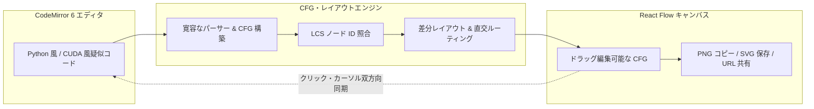
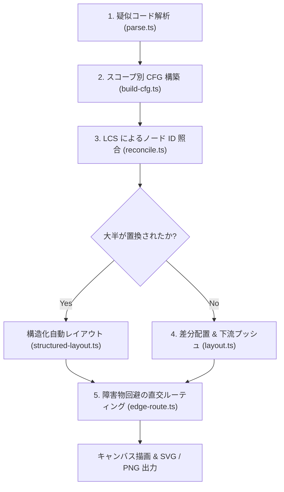

# Pseudo CFG

[English](README.md) | 日本語

**Python 風・CUDA 風の疑似コードから制御フローグラフ（CFG）をリアルタイム生成し、 手動配置を維持したまま編集できる Web アプリ**

デモ: [pseudo-cfg.r4ai.dev](https://pseudo-cfg.r4ai.dev)

## Why Pseudo CFG?

アルゴリズムの整理や仕様書・講義資料向けに制御フローグラフを作る際、従来のツールには以下の課題がある。

- **手動作図ツール（draw.io・Figma 等）**
  - 条件分岐やループを1つ追加するたびに、ノードの移動や矢印の引き直しが必要
- **コードからの自動生成ツール（Mermaid・Graphviz 等）**
  - コードを1文字変えるたびに全体が再レイアウトされ、手で整えた配置が消滅
  - 厳密な構文が要求され、書きかけのコードや自由記述の疑似コードで描画が破綻

`Pseudo CFG` は、寛容な疑似コードパーサーと差分レイアウトエンジンを組み合わせることでこれらを解決する。
左ペインで Python 風または CUDA 風の疑似コードを書き、右ペインでノード位置を微調整すると、以後のコード編集でも手動配置がそのまま維持される。

### Key Features

- **寛容な疑似コードパーサー**
  - `def`・`if` / `elif` / `else`・`while`・`for`・`break`・`continue`・`return`・`raise` を解析
  - `try` / `except` や `match` / `case` も近似分岐として表現し、その他の自由記述は通常の文として描画
  - 波括弧で区切る CUDA / C++ 風の構文にも切り替え可能で、`__global__` カーネルなどの関数、`if` / `else if` / `else`・`for`・`while`・`do` / `while`・フォールスルー付きの `switch` を解析
  - 到達不能コードやインデントの不整合を検出し、グラフを崩さずにエディタとノード上で警告
- **手動配置を維持する差分レイアウト**
  - 最長共通部分列（LCS）と種別マッチングにより、編集前後でノード ID を引き継ぎ
  - 手で動かしたノードは固定したまま、追加・拡大されたノードの下流だけをテキスト挿入のように下へシフト
  - `True` / `next` の主流路を縦一列に、`False` / `done` の分岐を右側の列に自動配置
- **障害物を回避する直交エッジルーティング**
  - ノードとの重なりを避ける専用レーン、角丸折れ線、交差部のジャンプ弧（hop）を自動計算
  - 分岐ラベル（`T`・`F`・`next`・`done`・`raise`）を線やノードと重ならない位置へ配置
- **エディタとダイアグラムの双方向同期**
  - VS Code / Monaco 互換のキーバインドとマルチカーソルを備えた CodeMirror 6 エディタ
  - ノードのクリックやカーソル移動で対応するソース行とノードを相互にハイライト
  - 基本ブロック単位（`Blocks`）と文単位（`Statements`）の粒度をワンクリックで切り替え
- **サーバーレス共有と高精細エクスポート**
  - コードを URL フラグメント（`#code=...`）にエンコードして共有（サーバーへの送信なし）
  - 状態はブラウザの `localStorage` に自動保存
  - 2倍解像度の PNG クリップボードコピー、およびドキュメント向けのライトテーマ SVG / PNG 保存に対応

## Usage

### Canvas & Toolbar Controls

| 操作                                               | 動作                                                                       |
| :------------------------------------------------- | :------------------------------------------------------------------------- |
| ノードをドラッグ                                   | 位置を調整 （コード編集後も維持され、`localStorage` に保存）            |
| 空白をドラッグ                                     | 矩形選択で複数ノードを選択                                                 |
| スクロール / `Space` + ドラッグ                    | キャンバスのパン移動                                                       |
| `⌘` / `Ctrl` + スクロール                          | ズームイン・ズームアウト                                                   |
| ノードをクリック                                   | エディタ上の対応するソース行をハイライト                                   |
| ノードをダブルクリック / `Enter`                   | 対応するソース行へエディタのカーソルを移動                                 |
| `⌘` / `Ctrl` + `Z` `⌘` / `Ctrl` + `Shift` + `Z` | レイアウト操作の取り消し・やり直し （キャンバスにフォーカスがあるとき） |
| `Blocks` / `Statements`                            | 基本ブロック単位 / 文単位のノード表示を切り替え                            |
| `Tidy up`                                          | 手動配置を破棄して構造化自動レイアウトを再実行                             |
| `Copy PNG` / エクスポートメニュー                  | 2倍解像度 PNG をクリップボードへコピー、または PNG / SVG 保存              |
| `Examples` / リンクボタン                          | サンプルコードの読み込み、または共有用 `#code=...` リンクのコピー          |
| 下部ステータスバー（Problems）                     | 構文エラー・到達不能コードの一覧表示と該当行へのジャンプ                   |

### Supported Syntax

| 構文                                    | グラフ上の表現                                                           |
| :-------------------------------------- | :----------------------------------------------------------------------- |
| `def name(args):`                       | 関数ごとに独立した CFG を生成し、横並びで配置                            |
| `if cond:` / `elif cond:` / `else:`     | ひし形の分岐ノード（下が緑の `T`、右が赤の `F`）                         |
| `while cond:`（`else:` 対応）           | ひし形のループヘッダ（`T` で本体へ、破線で先頭へ戻り、`F` で脱出）       |
| `for x in items:`（`else:` 対応）       | 六角形のループヘッダ（緑の `next` で本体へ、赤の `done` で脱出）         |
| `break` / `continue`                    | ループ出口へのジャンプエッジ、またはループ先頭への破線バックエッジ       |
| `return` / `raise`                      | スコープ終端ノードへの直接ジャンプエッジ（`raise` は赤ラベル）           |
| `try:` / `except:` / `match:` / `case:` | 順次実行ヘッダ＋各 `except` / `case` を分岐として近似表示（警告付き）    |
| その他の行                              | 通常の文ノード（`Blocks` モードでは連続する文を1つの基本ブロックに結合） |

### Editor Keybindings (Monaco-Compatible)

| ショートカット（macOS / Windows & Linux） | 動作                       |
| :---------------------------------------- | :------------------------- |
| `⌘D` / `Ctrl+D`                           | 次の一致を選択に追加       |
| `⌘⇧L` / `Ctrl+Shift+L`                    | 一致する文字列をすべて選択 |
| `⌥Click` / `Alt+Click`                    | カーソルを追加             |
| `⇧⌥Drag` / `Shift+Alt+Drag`               | 矩形（カラム）選択         |
| `⌘⌥↑/↓` / `Ctrl+Alt+↑/↓`                  | 上下にカーソルを追加       |
| `⌥↑/↓` / `Alt+↑/↓`                        | 行を上下に移動             |
| `⇧⌥↑/↓` / `Shift+Alt+↑/↓`                 | 行を上下に複製             |
| `⌘⇧K` / `Ctrl+Shift+K`                    | 行を削除                   |
| `⌘/` / `Ctrl+/`                           | コメントの切り替え         |
| `⌘]` / `⌘[`（`Ctrl+]` / `Ctrl+[`）        | インデント / アウトデント  |
| `⌘F` / `⌘⌥F`（`Ctrl+F` / `Ctrl+H`）       | 検索 / 置換                |
| `⌃G` / `Ctrl+G`                           | 指定行へ移動               |

## How It Works

1. **寛容なインデントパーサーと CFG 構築**
   - 括弧内の改行や継続行を結合してコメントを除去し、トップレベルおよび各 `def` ごとに CFG を構築
   - 到達不能コードや構文上の問題を非致命的な診断情報（Diagnostics）として記録
2. **LCS によるノード ID の引き継ぎ**
   - 編集前後のノード列を最長共通部分列（LCS）でアライメント
   - 一致ノード間のギャップにある同種ノードをペアリングし、文言を書き換えても ID と座標を維持
3. **構造化レイアウトと差分配置**
   - `True` / `next` の主流路を縦軸（スパイン）に置き、`False` / `done` の分岐を右隣へ配置
   - 既存ノードの座標はそのまま保ち、新規ノードは隣接ノードの移動量に合わせて配置したうえで、重なる下流ノードを下へ押し下げ
4. **直交エッジルーティング**
   - ノードの矩形を避ける垂直レーン、角丸パス、交差箇所のジャンプ弧、線やノードと重ならないラベル位置を算出

アルゴリズムの詳細は [Architecture & Internals](docs/architecture.ja.md) を参照する。

## Documentation

- [Architecture & Internals](docs/architecture.ja.md)：パーサー・CFG 構築・ノード照合・差分レイアウト・エッジルーティングの内部設計
- [Development & Deployment Guide](docs/development.ja.md)：開発環境・ディレクトリ構成・セキュリティ対策・Cloudflare デプロイ手順
