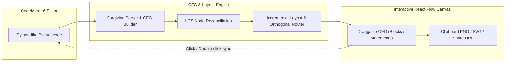
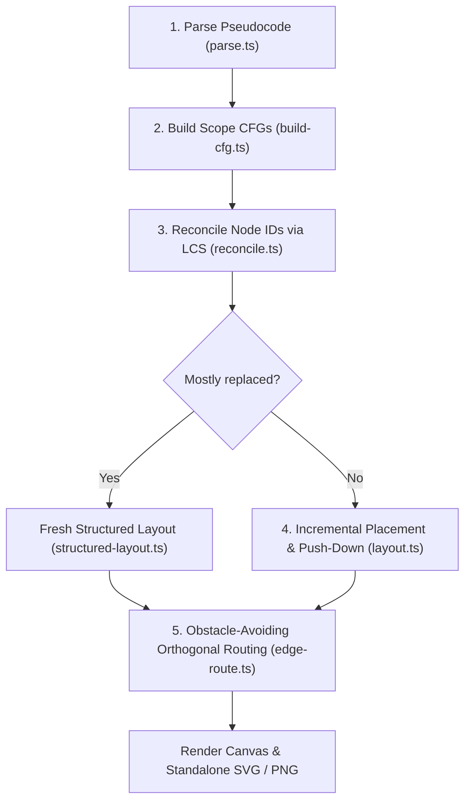

# Pseudo CFG

English | [日本語](README.ja.md)

**An interactive web application that generates live, layout-preserving control-flow graphs (CFGs) from Python-like pseudocode**

Live demo: [pseudo-cfg.r4ai.dev](https://pseudo-cfg.r4ai.dev)

## Why Pseudo CFG?

Creating control-flow graphs for algorithms, specifications, or lecture slides usually forces a trade-off:

- **Manual drawing tools (draw.io, Figma)**
  - Inserting a single `if` or loop requires moving nodes and re-routing arrows by hand
- **Pure code-to-diagram tools (Mermaid, Graphviz)**
  - Every edit triggers a full auto-layout that wipes out manual node positioning
  - Strict parsers break as soon as you write informal pseudocode or mid-edit syntax

`Pseudo CFG` combines a forgiving pseudocode parser with an incremental layout engine.
You write Python-like pseudocode on the left, fine-tune node positions on the right, and keep your layout intact as the code evolves.

### Key Features

- **Forgiving pseudocode parser**
  - Recognizes `def`, `if` / `elif` / `else`, `while`, `for`, `break`, `continue`, `return`, and `raise`
  - Approximates `try` / `except` and `match` / `case` as branches and treats any other text as a plain statement
  - Detects unreachable code and indentation errors inline without collapsing the diagram
- **Edit-preserving incremental layout**
  - Reconciles node IDs across edits using longest common subsequence (LCS) matching
  - Preserves manually dragged node positions and pushes lower nodes down like inserting a text line
  - Places `True` / `next` paths straight down and `False` / `done` branches in columns to the right
- **Obstacle-avoiding orthogonal routing**
  - Routes edges around nodes with dedicated vertical lanes, rounded corners, and line-crossing hops
  - Places branch labels (`T`, `F`, `next`, `done`, `raise`) in collision-free positions
- **Bidirectional editor–diagram sync**
  - CodeMirror 6 editor with VS Code / Monaco keybindings and multi-cursor editing
  - Clicking a node highlights its source lines; moving the editor cursor highlights the active node
  - Switches between basic-block (`Blocks`) and per-statement (`Statements`) granularity
- **Serverless sharing & crisp export**
  - Encodes code into `#code=...` URL fragments (never sent to a server) and saves state in `localStorage`
  - Copies 2x retina PNGs to the clipboard or downloads standalone light-theme SVG and PNG files

## Usage

### Canvas & Toolbar Controls

| Action                                             | Effect                                                                       |
| :------------------------------------------------- | :--------------------------------------------------------------------------- |
| Drag a node                                        | Adjust position (preserved across code edits and saved in `localStorage`) |
| Drag empty canvas                                  | Box-select multiple nodes                                                    |
| Scroll / `Space` + drag                            | Pan the canvas                                                               |
| `⌘` / `Ctrl` + scroll                              | Zoom in or out                                                               |
| Click a node                                       | Highlight corresponding lines in the editor                                  |
| Double-click / `Enter` on a node                   | Jump editor cursor to the node's source line                                 |
| `⌘` / `Ctrl` + `Z` `⌘` / `Ctrl` + `Shift` + `Z` | Undo / redo layout changes (when the canvas is focused)                   |
| `Blocks` / `Statements`                            | Toggle between basic-block nodes and single-statement nodes                  |
| `Tidy up`                                          | Discard manual adjustments and run a fresh structured layout                 |
| `Copy PNG` / Export menu                           | Copy a 2x PNG to the clipboard or download as PNG / SVG                      |
| `Examples` / Link button                           | Load sample pseudocode or copy a `#code=...` share URL                       |
| Problems status bar                                | Open syntax / unreachable-code diagnostics and jump to the line              |

### Supported Syntax

| Construct                               | Graph Representation                                                         |
| :-------------------------------------- | :--------------------------------------------------------------------------- |
| `def name(args):`                       | Separate CFG component placed side by side with other scopes                 |
| `if cond:` / `elif cond:` / `else:`     | Diamond branch node with green `T` (down) and red `F` (right) exits          |
| `while cond:` (+ optional `else:`)      | Diamond header with `T` loop body, dashed back edge, and `F` exit            |
| `for x in items:` (+ optional `else:`)  | Hexagon header with green `next` body, dashed back edge, and red `done` exit |
| `break` / `continue`                    | Jump edge to the loop exit or dashed back edge to the loop header            |
| `return` / `raise`                      | Jump edge directly to the scope's end node (`raise` labeled in red)          |
| `try:` / `except:` / `match:` / `case:` | Sequential header with optional branch per `except` or `case` (with warning) |
| Any other line                          | Plain statement node (merged into basic blocks in `Blocks` mode)             |

### Editor Keybindings (Monaco-Compatible)

| Shortcut (macOS / Windows & Linux) | Action                   |
| :--------------------------------- | :----------------------- |
| `⌘D` / `Ctrl+D`                    | Select next occurrence   |
| `⌘⇧L` / `Ctrl+Shift+L`             | Select all occurrences   |
| `⌥Click` / `Alt+Click`             | Add cursor               |
| `⇧⌥Drag` / `Shift+Alt+Drag`        | Box (column) selection   |
| `⌘⌥↑/↓` / `Ctrl+Alt+↑/↓`           | Add cursor above / below |
| `⌥↑/↓` / `Alt+↑/↓`                 | Move line up / down      |
| `⇧⌥↑/↓` / `Shift+Alt+↑/↓`          | Copy line up / down      |
| `⌘⇧K` / `Ctrl+Shift+K`             | Delete line              |
| `⌘/` / `Ctrl+/`                    | Toggle line comment      |
| `⌘]` / `⌘[` (`Ctrl+]` / `Ctrl+[`)  | Indent / outdent line    |
| `⌘F` / `⌘⌥F` (`Ctrl+F` / `Ctrl+H`) | Find / replace           |
| `⌃G` / `Ctrl+G`                    | Go to line               |

## How It Works

1. **Forgiving Indentation Parser & CFG Builder**
   - Joins bracketed multiline expressions, strips comments, and builds one CFG per scope (`top-level` and each `def`)
   - Flags unreachable statements and syntax issues as non-fatal diagnostics
2. **LCS Node Reconciliation**
   - Aligns unchanged nodes between the previous and new CFG via longest common subsequence (LCS)
   - Pairs remaining nodes of the same kind within gaps so in-place text edits keep their node ID and position
3. **Structured & Incremental Layout**
   - Lays out the main `True` / `next` spine vertically and places `False` / `done` branches to the right
   - Keeps surviving nodes at their manual coordinates, offsets newly inserted nodes relative to neighbors, and pushes overlapping downstream nodes down
4. **Orthogonal Edge Routing**
   - Computes obstacle-avoiding polylines with separated vertical lanes, rounded corners, line-crossing hops, and collision-free label placement

See [Architecture & Internals](docs/architecture.md) for algorithm details.

## Documentation

- [Architecture & Internals](docs/architecture.md): parser, CFG construction, node reconciliation, layout, and edge routing
- [Development & Deployment Guide](docs/development.md): local setup, project structure, security hardening, and Cloudflare deployment
