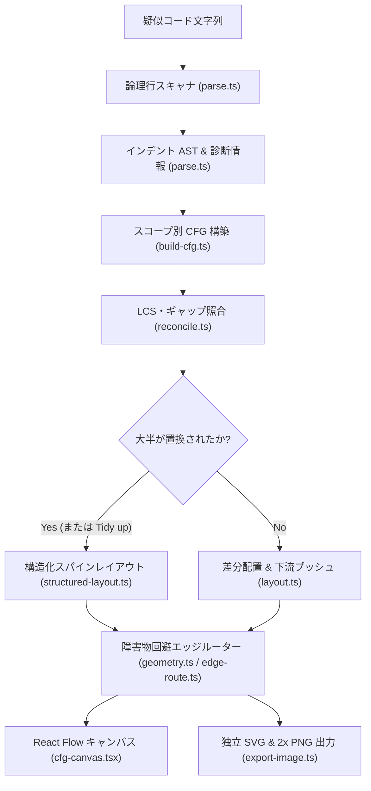
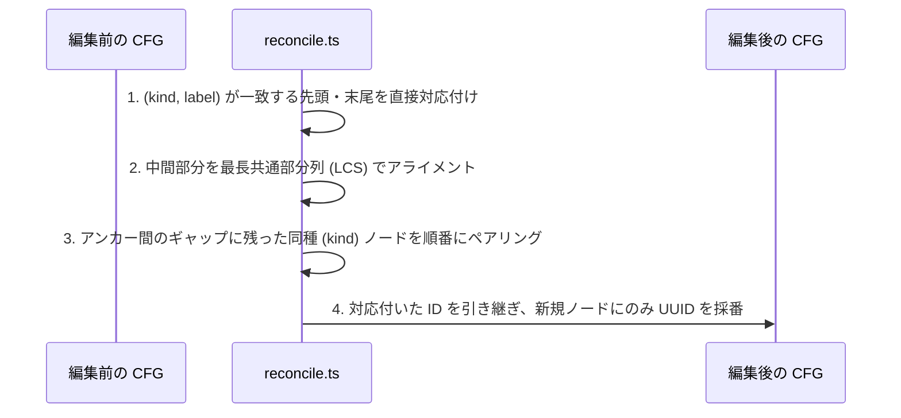

# Architecture & Internals

[English](architecture.md) | 日本語

本ドキュメントでは `Pseudo CFG` の内部設計について解説する。
Python 風・CUDA 風疑似コードのパース、CFG の構築、編集前後でのノード ID 照合、差分レイアウト、直交エッジルーティングおよび画像出力の仕組みを扱う。

## 1. Forgiving Pseudocode Parser (`src/features/cfg/parse.ts`)

厳密な構文エラーで停止する一般的なコンパイラと異なり、書きかけのコードや自然言語混じりの疑似コードでも常にグラフを生成できるよう設計されている。

### Logical Line Scanning

1. **コメントと空行の除去**
   - 文字列リテラル外の `#` コメントと空行を除外
2. **括弧内改行とバックスラッシュ継続行の結合**
   - 開いた括弧 `()`・`[]`・`{}` の内部や末尾 `\` に続く行を1つの論理行に結合
   - 単一引用符および三重引用符（`"""` / `'''`）の開閉を追跡
3. **未終了の三重引用符からの回復**
   - 入力途中の閉じられていない三重引用符を検出した場合、開始行にエラーを記録したうえで後続行を通常通り解析し、グラフ全体の消失を防止

### Indentation & Statement Parsing

- **基準インデントの自動決定**
  - ファイル内で最も浅いインデント幅をトップレベルの基準とし、先頭行がインデントされていても全体を解析
- **制御構文ヘッダの認識**
  - `if` / `elif` / `else`、`while`（`else` 対応）、`for`（`else` 対応）、`def` を認識
  - `if x < 0: return 0` のような1行インライン本体にも対応
- **ジャンプ・脱出文**
  - 行頭の識別子単位で `break`・`continue`・`return`・`raise` を判定（`return値` 等は通常の文として扱う）
- **近似ブロック構文**
  - `try`・`finally`・`match`・`with`・`class`・`async` はヘッダを通常の文として置き、本体を順次接続
  - `except` と `case` は分岐として扱い、`try` と `match` には近似表示である旨の警告（warning）を付与
- **フォールバック規則**
  - 上記以外のすべての行は通常の文（`simple`）として扱う

### CUDA-like Syntax (`src/features/cfg/parse-cuda.ts`)

波括弧で区切るコードも同じ文の木に変換するため、以降の処理はすべて共通である。

- **字句解析**
  - `//`・`/* */` コメントとプリプロセッサ行（`#include`・`#pragma unroll` など）を除去し、文字列・文字リテラル内の波括弧やセミコロンは無視
- **文の解析**
  - 文は `;` までとし、その内部の波括弧（初期化子リストやラムダ本体）は文の一部として扱う。`kernel<<<grid, block>>>(...)` の起動も通常の文になる
  - `if` / `else if` / `else`・`while`・`for`（`for (;;)` は出口なし）・`do` / `while`・`switch` / `case` / `default` を本体の波括弧の有無にかかわらず認識
  - `try` / `catch` は Python の `try` / `except` と同様に近似
- **関数**
  - 関数本体の外で引数リストに続く `{` を関数定義とみなし、シグネチャ全体をラベルとする独立したグラフを生成
  - 関数を含むファイルでは、C では関数外のコードが実行されないため、トップレベルの宣言（グローバル変数・`struct` 定義・プロトタイプ）を省略

## 2. CFG Construction (`src/features/cfg/build-cfg.ts`)

`buildCfg(source, granularity, language)` は AST を走査し、ノード（`start`・`end`・`block`・`branch`・`loop`）と有向エッジに変換する。

- **スコープごとの連結成分**
  - トップレベルのコードは `Start` → `End` のグラフを生成
  - 各 `def name(...):` は独立した `def name(...)` → `return` のグラフを生成
  - トップレベルに関数定義（`def`）のみが存在する場合、空の `Start` → `End` グラフは省略
- **ポートリストによる1パス結線**
  - 各文は未接続の出口リスト（`Port[]`）を受け取り、後続へ抜ける出口リストを返す
  - `return` と `raise` は `jump: true` でスコープ終端ノードへ直結し、後続への出口を空にする
  - `break` は現在のループの脱出ポートへ追加し、`continue` は `back: true` でループヘッダへ接続
- **表示粒度（`Blocks` / `Statements`）**
  - `block` モードでは、連続する `simple` 文（および末尾の `return` / `raise`）を1つの基本ブロックノードへ結合
  - `statement` モードでは、1文ごとに独立したノードを生成
- **到達不能コードの検出**
  - 全 `start` ノードから到達可能性を走査し、未到達のノードに `Unreachable code` の警告を付与

## 3. Node Identity Reconciliation (`src/features/cfg/reconcile.ts`)

コード編集のたびに `buildCfg` が新しいグラフを生成するため、手動配置を維持するには編集前後でノード ID を引き継ぐ必要がある。

1. **完全一致ノードの LCS アライメント（`alignByLabel`）**
   - `(kind, label)` の組が一致するノードを最長共通部分列（LCS）で対応付け
   - 共通のプレフィックスとサフィックスを先に除外し、編集された中間領域のみで DP テーブルを計算
2. **インプレース編集のペアリング（`pairEditedNodes`）**
   - LCS で対応付いたアンカー間のギャップ内で、残った同じ `kind` のノードを出現順にペアリング
   - これにより、文や条件式を書き換えている最中も同一ノードとみなされ、ID と手動配置が維持される

## 4. Structured & Incremental Layout (`src/features/diagram/`)

### Node Sizing (`layout.ts`)

- 等幅フォントの文字幅（`CHAR_WIDTH = 7.8`、日本語等の全角文字は2カラム換算）から、DOM 計測を待たずにノードの矩形サイズを決定論的に算出
- 56カラムを超える長い行は単語境界で自動折り返し
- 1行の `branch` はテキストが内接矩形に収まるひし形、複数行の `branch` と `loop` は六角形としてサイズを計算

### Fresh Structured Layout (`structured-layout.ts`)

初回読み込み時、`Tidy up` 実行時、またはコードの大半が書き換えられた際に使用される構造化レイアウト。

- **垂直メインスパイン（背骨）**
  - `True` および `next` の経路を `cx = 0` の縦軸に沿って真っ直ぐ下へ配置
  - `False` および `done` の経路は右側へ新しい列（`GAP_X = 40`）を開いて配置
  - 分岐した2経路は、ソース順で最初に合流する共通ノードで再びメインスパインに戻る
- **早期ジャンプによる崩れの防止**
  - `return`・`raise`・`break` のジャンプエッジはスパイン計算から除外し、ガード節（早期 return）の直後のコードが右へずれずメイン列に残るよう制御
- **複数スコープの横並び配置**
  - トップレベルと各 `def` の連結成分を個別にレイアウトし、横幅 `1600 px` で折り返しながら横並びに配置

### Incremental Placement (`placeIncrementally` in `layout.ts`)

通常のコード編集時（`!mostlyReplaced`）に手動配置を維持する差分レイアウト。

1. **既存ノードの座標維持**
   - 前回のグラフから ID を引き継いだすべてのノードは、現在の `(x, y)` 座標をそのまま維持
2. **新規ノードの相対オフセット配置**
   - 新規ノードが追加されたスコープのみ構造化レイアウトを計算
   - 接続元の先輩ノード（または後続ノード）が手動移動された平均オフセットを新規ノードの自動座標に加算して配置
3. **重なり解消と下流プッシュ（`makeRoom`）**
   - 追加またはサイズ変化したノードを上から順に処理
   - 他のノードと重なる場合や、追加ノードの下流につながるノードが上にある場合、テキストエディタで行を挿入したときのように下流ノード群を `GAP = 28 px` ずつ下へ押し下げ（並列分岐の位置は動かさない）

## 5. Orthogonal Edge Routing & Export (`edge-route.ts`, `export-image.ts`)

### Obstacle-Avoiding Orthogonal Router

ユーザーがノードを自由にドラッグしても線が読みやすく保たれるよう、現在のノード矩形群から毎フレーム直交ポリラインを計算する。

- **出口・入口アンカーの固定**
  - `True` / `next` および通常エッジはノード下端中央から、`False` / `done` は右頂点から出発
  - すべてのエッジはターゲットノードの上端へ進入（上辺が平らな `block` ノードには中心からずれた垂直線の直接進入を許可）
- **方向別の迂回と垂直レーン分離**
  - 右側へ抜ける経路（`False`・`done`・`break`・`return`）は、障害物ノードや使用済み垂直レーンを右方向へ避けながら迂回（`LANE_GAP = 20 px`）
  - ループの戻りエッジ（`back: true`）はループ本体の左側に専用レーンを確保して上昇
- **角丸パスと交差部のジャンプ弧（Hops）**
  - `roundedPath` が直交折れ線の角を半径 `8 px` の二次ベジェ曲線に変換
  - `crossings` が水平線と垂直線の交差点を検出し、水平線側に半径 `6 px` の半円ジャンプ弧（近接する交差は1つの広い弧に結合）を描画
- **衝突しないラベル配置（`clearSpot`）**
  - エッジ始点付近の候補座標を順に検査し、どのノード矩形とも他のエッジ線とも重ならない最初の位置にラベルを配置

### Standalone SVG & 2x PNG Export

- `diagramToSvg` は画面の DOM・ダークモード・ズーム倍率・選択状態に依存せず、CFG モデルとルーティング結果から直接ライトテーマの独立した SVG を生成
- `svgToPng` は生成した SVG をオフスクリーン Canvas 上で2倍解像度（ブラウザ上限の1辺 `16,384 px`・総画素 `100M px` 以内に自動調整）でラスタライズし、クリップボードへの PNG コピーやファイル保存を実行
