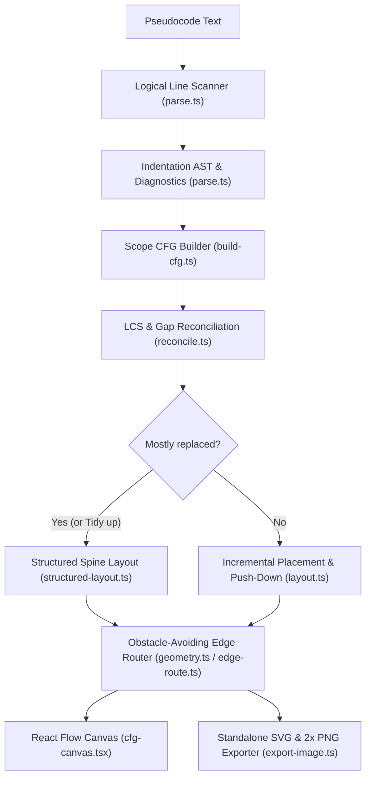
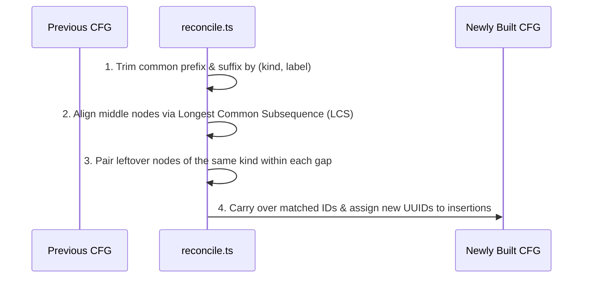

# Architecture & Internals

English | [日本語](architecture.ja.md)

This document explains the internal pipeline of `Pseudo CFG`:
how Python-like and CUDA-like pseudocode is parsed into a control-flow graph, how node identities and positions survive edits, and how orthogonal edges are routed and exported.

## 1. Forgiving Pseudocode Parser (`src/features/cfg/parse.ts`)

Unlike a strict language parser that aborts on syntax errors, the parser is designed so incomplete drafts and free-form pseudocode still produce a readable graph.

### Logical Line Scanning

1. **Comment & blank line removal**
   - Strips `#` comments outside string literals and skips empty lines
2. **Implicit & explicit line continuations**
   - Joins lines inside open brackets `()`, `[]`, `{}` or after a trailing backslash `\`
   - Tracks single-quoted and triple-quoted (`"""` / `'''`) strings across lines
3. **Unterminated string recovery**
   - If a triple-quoted string is left unclosed (common while typing), records an error on the opening line and resumes parsing subsequent lines normally so the rest of the graph does not collapse

### Indentation & Statement Parsing

- **Top-level baseline**
  - Uses the shallowest indentation in the file as the top-level block so an accidentally indented first line does not hide the rest
- **Recognized control-flow headers**
  - `if` / `elif` / `else`, `while` (with optional `else`), `for` (with optional `else`), and `def`
  - Supports inline single-statement bodies (e.g., `if x < 0: return 0`)
- **Jumps & exits**
  - `break`, `continue`, `return`, and `raise` (matched by whole leading identifier so `return_value` is treated as a plain statement)
- **Approximate compound blocks**
  - `try`, `finally`, `match`, `with`, `class`, and `async` headers become sequential statements followed by their body
  - `except` and `case` clauses become optional branches, emitting a warning on `try` and `match` that their flow is approximated
- **Fallback rule**
  - Any unrecognized line becomes a `simple` statement

### CUDA-like Syntax (`src/features/cfg/parse-cuda.ts`)

Brace-delimited code is parsed into the same statement tree, so everything downstream is shared.

- **Tokenizing**
  - Drops `//` and `/* */` comments and preprocessor lines (`#include`, `#pragma unroll`, ...); string and character literals keep their braces and semicolons
- **Statements**
  - A statement runs to its `;`; braces inside it (initializer lists, lambda bodies) stay part of the statement, and `kernel<<<grid, block>>>(...)` launches are plain statements
  - `if` / `else if` / `else`, `while`, `for` (`for (;;)` has no exit), `do` / `while`, and `switch` / `case` / `default` are recognized with or without braces around their bodies
  - `try` / `catch` is approximated like Python's `try` / `except`
- **Functions**
  - Outside function bodies, a `{` after a parameter list opens a function graph labelled with its whole signature
  - Once a file has functions, top-level declarations (globals, `struct` definitions, prototypes) are left out, since C runs no code outside functions

## 2. CFG Construction (`src/features/cfg/build-cfg.ts`)

`buildCfg(source, granularity, language)` converts the parsed statement tree into nodes (`start`, `end`, `block`, `branch`, `loop`) and directed edges.

- **One connected component per scope**
  - Top-level statements form a `Start` → `End` graph
  - Each `def name(...):` body is emitted as its own `def name(...)` → `return` graph
  - When a file contains only `def` blocks and no top-level statements, the empty top-level graph is omitted
- **Port-based single-pass wiring**
  - Each statement consumes a list of incoming dangling exits (`Port`) and returns the exits that fall through
  - `return` and `raise` connect immediately to the scope's exit node with `jump: true` and leave no fallthrough ports
  - `break` pushes a jump port onto the enclosing loop's break list; `continue` connects directly to the loop header with `back: true`
- **Granularity (`Blocks` vs. `Statements`)**
  - In `block` mode, consecutive `simple` statements (and trailing `return` / `raise`) coalesce into a single basic-block node
  - In `statement` mode, every statement creates its own node
- **Unreachable code detection**
  - Runs a reachability traversal from every `start` node and attaches an `Unreachable code` warning to any unvisited statement node

## 3. Node Identity Reconciliation (`src/features/cfg/reconcile.ts`)

Because `buildCfg` runs from scratch on every keystroke, nodes need stable IDs so manual positions survive edits.

1. **Exact alignment (`alignByLabel`)**
   - Matches nodes with identical `(kind, label)` signatures using longest common subsequence (LCS)
   - Strips matching prefixes and suffixes first so the dynamic programming table only covers the edited region
2. **In-place edit pairing (`pairEditedNodes`)**
   - Within each gap between two LCS anchors, pairs leftover old and new nodes of the same `kind` in source order
   - Typing inside a statement or condition therefore updates the node in place without losing its ID or position

## 4. Structured & Incremental Layout (`src/features/diagram/`)

### Node Sizing (`layout.ts`)

- Monospace character metrics (`CHAR_WIDTH = 7.8`, CJK wide characters counted as 2 columns) allow node dimensions to be computed deterministically without waiting for DOM measurement
- Lines exceeding 56 columns wrap at word boundaries
- Single-line `branch` nodes render as diamonds sized so their inscribed rectangle fits the text; multi-line `branch` and `loop` nodes render as hexagons

### Fresh Structured Layout (`structured-layout.ts`)

Used on initial load, when clicking `Tidy up`, or when most of the code is replaced:

- **Vertical main spine**
  - `True` and `next` branches continue straight down along `cx = 0`
  - `False` and `done` branches open a parallel column to the right (`GAP_X = 40`)
  - Branches rejoin at their first common post-dominating node in source order
- **Jumps do not skew the spine**
  - `return`, `raise`, and `break` edges are marked `jump: true` and excluded from spine placement, keeping code after an early return aligned in the main column
- **Multi-scope arrangement**
  - Connected components (top-level and each `def`) are laid out independently and placed side by side, wrapping into rows at `1600 px`

### Incremental Placement (`placeIncrementally` in `layout.ts`)

When editing an existing graph (`!mostlyReplaced`):

1. **Preserve surviving nodes**
   - Every node whose ID existed in the previous graph keeps its exact `(x, y)` coordinates
2. **Relative offset for new nodes**
   - Computes the fresh structured layout only for scopes that gained a new node
   - Places each new node at its structured position shifted by the average manual offset of its predecessor (or successor) nodes
3. **Push-down overlap resolution (`makeRoom`)**
   - Sorts newly added or resized nodes top-to-bottom
   - Pushes overlapping nodes and forward-reachable descendants down by `GAP = 28 px`, mimicking how inserting a line in a text editor pushes subsequent lines down while leaving parallel branches untouched

## 5. Orthogonal Edge Routing & Export (`edge-route.ts`, `export-image.ts`)

### Obstacle-Avoiding Orthogonal Router

Edges are routed dynamically from the current node bounding boxes so the diagram stays readable even after manual dragging:

- **Fixed exit & entry anchors**
  - `True` / `next` and plain edges exit from the bottom midpoint; `False` / `done` edges exit from the right vertex
  - All edges enter their target from the top (off-center straight plumb lines are allowed into flat-topped basic blocks)
- **Directional detours & vertical lanes**
  - Forward detours (`False`, `done`, `break`, `return`) step right past obstacle boxes and previously claimed vertical lanes (`LANE_GAP = 20 px`)
  - Loop back edges climb in dedicated lanes to the left of the loop body
- **Rounded corners & line-crossing hops**
  - `roundedPath` converts orthogonal polylines into SVG paths with `8 px` quadratic-bezier corners
  - `crossings` detects horizontal-over-vertical intersections and draws semicircular hop arcs (`6 px` radius, merging adjacent crossings)
- **Collision-free labels (`clearSpot`)**
  - Generates candidate spots tucked beside the start of the edge and picks the first spot that overlaps no node box and no edge polyline

### Standalone SVG & 2x PNG Export

- `diagramToSvg` builds a self-contained light-palette SVG directly from the `Cfg` model and routed geometry, independent of dark mode, zoom level, or selection state
- `svgToPng` rasterizes the SVG onto an offscreen canvas at `2x` pixel ratio (clamped to browser canvas limits of `16,384 px` per side / `100M` pixels) and writes the `image/png` blob to the clipboard or triggers a file download
